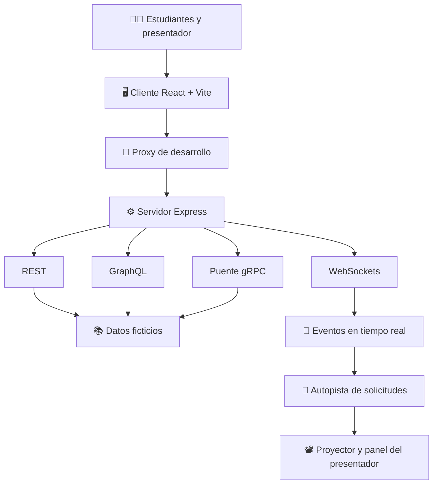

# ⚡ SyncLab | Laboratorio interactivo de comunicación

<p align="center">
  <br>


<br><br>
  
  
  

</p>
<p align="center">
  <strong>Comprende. Experimenta. Compara. Aprende.</strong>
  <br/>
  Un laboratorio docente para descubrir cómo se comunican las aplicaciones modernas a través de una experiencia práctica, visual e interactiva.
</p>

<p align="center">
  <a href="#-bienvenido-a-synclab">Explorar el laboratorio</a> ·
  <a href="#-ruta-de-aprendizaje">Ruta de aprendizaje</a> ·
  <a href="#-manos-a-la-obra">Comenzar práctica</a> ·
  <a href="#-autoevaluación">Autoevaluación</a>
</p>

---

## 🧭 Navegación

| Sección | ¿Qué encontrarás? |
|---|---|
| [🎯 Introducción](#-bienvenido-a-synclab) | Contexto y propósito del laboratorio |
| [📚 Objetivos](#-objetivos-de-aprendizaje) | Competencias que desarrollarás |
| [🗺️ Ruta de aprendizaje](#-ruta-de-aprendizaje) | Actividades antes, durante y después de clase |
| [🌐 Protocolos](#-los-cuatro-protagonistas) | REST, GraphQL, gRPC y WebSockets |
| [🏗️ Arquitectura](#️-cómo-funciona-el-laboratorio) | Componentes y comunicación |
| [🚀 Instalación](#-manos-a-la-obra) | Requisitos y ejecución |
| [🧪 Experimentos](#-laboratorio-práctico) | Pruebas guiadas |
| [❓ Autoevaluación](#-autoevaluación) | Preguntas para comprobar lo aprendido |
| [📁 Estructura](#-estructura-del-proyecto) | Organización del código |
| [👥 Créditos](#-créditos-y-reconocimientos) | Información académica |

## ⚡ Bienvenido a SyncLab

¿Alguna vez te has preguntado cómo una aplicación consulta información, envía datos al servidor o recibe actualizaciones en tiempo real?

**SyncLab** es una propuesta de laboratorio educativo que permite explorar estas interacciones mediante cuatro tecnologías de comunicación: REST, GraphQL, gRPC y WebSockets.

En lugar de estudiar únicamente definiciones teóricas, podrás observar solicitudes, respuestas, eventos, latencia y procesamiento de peticiones dentro de una simulación compartida.

> [!NOTE]
> Este proyecto está orientado al aprendizaje práctico. Los datos de estudiantes y matrículas son ficticios y se utilizan exclusivamente con fines educativos.

### 💡 El reto de aprendizaje

Imagina un sistema universitario que necesita consultar estudiantes, registrar matrículas y mantener actualizados a sus usuarios.

¿Todos estos requerimientos necesitan la misma forma de comunicación?

Con SyncLab podrás experimentar con diferentes mecanismos, observar su comportamiento y reflexionar sobre sus ventajas, limitaciones y casos de uso.

## 🎯 Objetivos de aprendizaje

Al finalizar la actividad, podrás:

- [ ] Explicar el funcionamiento básico de una arquitectura cliente-servidor.
- [ ] Diferenciar REST, GraphQL, gRPC y WebSockets.
- [ ] Identificar solicitudes, respuestas y mensajes intercambiados.
- [ ] Interpretar el efecto de la latencia en una comunicación.
- [ ] Observar cómo una solicitud entra en una cola y se procesa.
- [ ] Relacionar cada tecnología con escenarios de aplicación.
- [ ] Argumentar qué mecanismo de comunicación elegirías para un problema concreto.

## 🗺️ Ruta de aprendizaje

La clase invertida distribuye el aprendizaje entre el trabajo autónomo y la experimentación en el aula.

<details open>
<summary><strong>📖 Fase 1 · Antes de clase</strong></summary>

**Objetivo:** familiarizarse con los conceptos esenciales.

1. Investiga qué es una API y cómo funciona el modelo cliente-servidor.
2. Lee las definiciones de REST, GraphQL, gRPC y WebSockets.
3. Identifica un ejemplo cotidiano de comunicación entre aplicaciones.
4. Anota una duda sobre las diferencias entre los cuatro mecanismos.

**Producto esperado:** una breve explicación de cada tecnología y una pregunta para discutir en clase.

</details>

<details>
<summary><strong>🧪 Fase 2 · Durante la clase</strong></summary>

**Objetivo:** experimentar y analizar el comportamiento de las comunicaciones.

1. Accede al laboratorio desde el computador o tu dispositivo móvil.
2. Ingresa con un apodo.
3. Selecciona un protocolo de comunicación.
4. Ejecuta operaciones y observa la autopista de solicitudes.
5. Compara los resultados con los de tus compañeros.
6. Modifica la latencia y describe los cambios observados.

**Producto esperado:** una tabla comparativa con observaciones reales del laboratorio.

</details>

<details>
<summary><strong>🧠 Fase 3 · Después de clase</strong></summary>

**Objetivo:** consolidar y transferir lo aprendido.

1. Completa la autoevaluación.
2. Elabora una conclusión sobre las diferencias entre los protocolos.
3. Propón un caso de uso para cada tecnología.
4. Justifica qué mecanismo utilizarías en una aplicación universitaria.

**Producto esperado:** una reflexión técnica fundamentada en los experimentos.

</details>

## 🌐 Los cuatro protagonistas

### 1. REST — Recursos y operaciones HTTP

REST permite acceder y manipular recursos mediante convenciones basadas en HTTP.

**En el laboratorio:** consulta estudiantes y crea matrículas ficticias.

| Método | Ejemplo | Propósito |
|---|---|---|
| `GET` | `/api/estudiantes` | Consultar la colección |
| `GET` | `/api/estudiantes/1` | Consultar un estudiante |
| `POST` | `/api/matriculas` | Registrar una matrícula ficticia |

**Pregunta clave:** ¿qué método HTTP utilizarías para consultar un recurso sin crearlo?

### 2. GraphQL — Consulta los datos que necesitas

GraphQL permite solicitar campos específicos mediante una consulta definida por el cliente.

**En el laboratorio:** consulta información de estudiantes seleccionando los campos que necesitas.

Ejemplo conceptual:

```graphql
query {
  estudiantes {
    id
    nombre
  }
}
```

La consulta ilustra cómo solicitar determinados campos. Los nombres exactos disponibles dependen del esquema implementado en el servidor.

**Pregunta clave:** ¿qué ventaja puede ofrecer seleccionar únicamente los campos necesarios?

### 3. gRPC — Comunicación mediante contratos

gRPC permite definir servicios y mensajes mediante Protocol Buffers, facilitando una comunicación estructurada entre aplicaciones.

**En el laboratorio:** invoca el servicio de estudiantes a través del puente gRPC disponible.

El proyecto utiliza contratos ubicados en `proto/` y un servidor gRPC. La interfaz web accede a este servicio mediante una ruta puente.

**Pregunta clave:** ¿por qué resulta útil definir previamente la estructura de los mensajes?

### 4. WebSockets — Comunicación bidireccional

WebSockets mantienen un canal de comunicación persistente que permite intercambiar mensajes en ambos sentidos.

**En el laboratorio:** envía mensajes al chat y observa los eventos que se distribuyen a los participantes.

A diferencia del patrón habitual de petición-respuesta HTTP, un canal WebSocket permite que el servidor envíe eventos sin esperar una nueva petición HTTP por cada actualización.

**Pregunta clave:** ¿en qué escenario sería útil recibir actualizaciones sin consultar repetidamente al servidor?

## 📊 Comparación rápida

| Característica | REST | GraphQL | gRPC | WebSockets |
|---|---|---|---|---|
| Interacción principal | Petición HTTP | Consulta y respuesta | Llamada a procedimiento remoto | Mensajes bidireccionales |
| Datos | Recursos y representaciones | Campos solicitados | Mensajes tipados | Mensajes definidos por la aplicación |
| Contrato | Convenciones y endpoints | Esquema GraphQL | Archivos `.proto` | Protocolo y formato acordados |
| Uso frecuente | APIs web | Consultas flexibles | Servicios entre sistemas | Chats y eventos en vivo |
| Ejemplo del laboratorio | Estudiantes y matrículas | Consultas de estudiantes | Servicio de estudiantes | Chat del aula |

> [!TIP]
> Ninguna tecnología es universalmente superior. La elección depende de los requisitos, la arquitectura, el volumen de datos, la necesidad de comunicación en tiempo real y las restricciones del sistema.

## 🏗️ Cómo funciona el laboratorio

El proyecto integra una interfaz web, un servidor y varios mecanismos de comunicación que comparten el contexto de una simulación.



### 🔄 Flujo de una solicitud

1. El participante selecciona una operación y un protocolo.
2. El cliente envía la solicitud al servicio correspondiente.
3. El servidor aplica la configuración de latencia y procesa la operación.
4. La cola y el estado de la simulación se actualizan.
5. Los eventos disponibles se distribuyen a través del canal WebSocket.
6. El proyector muestra la evolución del laboratorio.

El comportamiento exacto depende del modo de ejecución y de la implementación de cada módulo.

## 🚀 Manos a la obra

### Requisitos previos

- Node.js 20 o superior.
- npm 10 o superior.
- Git.
- Un navegador moderno.
- Para la actividad grupal: computador y dispositivos conectados a la misma red Wi-Fi.

### 1. Clonar el repositorio

```bash
git clone https://github.com/Jossibel/ClaseInvertidaU1.git
cd ClaseInvertidaU1
```

> [!IMPORTANT]
> Verifica que este repositorio contenga los archivos de SyncLab descritos en esta guía. El README público consultado inicialmente no mostraba la estructura `client/`, `server/` y `packages/shared/`. Si el código está en otra rama o repositorio, clona la ubicación correcta antes de continuar.

### 2. Instalar dependencias

Desde la raíz del monorepo:

```bash
npm install
```

### 3. Iniciar el laboratorio

```bash
npm run dev
```

Según la configuración documentada para SyncLab:

| Servicio | Dirección local | Función |
|---|---|---|
| Cliente Vite | `http://localhost:5173` | Interfaz web |
| Servidor Express | `http://localhost:3001` | API y servicios |
| gRPC | `localhost:50051` | Servicio de comunicación |

El cliente utiliza el proxy de Vite para acceder a los servicios del servidor durante el desarrollo.

### 4. Abrir las interfaces

| Ruta | Función |
|---|---|
| `/proyector` | Visualización compartida del laboratorio |
| `/jugar` | Acceso de participantes |
| `/presentador` | Control de rondas y simulación |
| `/rest` | Exploración del módulo REST |
| `/graphql` | Exploración del módulo GraphQL |
| `/grpc` | Exploración del módulo gRPC |
| `/websockets` | Exploración del módulo WebSockets |

Para acceder, agrega cada ruta a `http://localhost:5173`.

## 📱 Conectar celulares a la misma red

Para una clase presencial, los estudiantes pueden entrar desde sus propios dispositivos.

1. Ejecuta el laboratorio en el computador del docente.
2. Averigua la dirección IPv4 local del computador.
3. Permite conexiones entrantes TCP al puerto `5173` en el firewall, si es necesario.
4. Abre `/proyector` en el equipo conectado al proyector.
5. Conecta los celulares a la misma red Wi-Fi.
6. Escanea el QR mostrado en el laboratorio o abre la dirección de red seguida de `/jugar`.

Ejemplo ilustrativo:

```text
http://192.168.1.82:5173/jugar
```

La IP es solo un ejemplo: utiliza la dirección que informe tu servidor.

En Fedora con `firewalld`, puedes permitir temporalmente el acceso con:

```bash
sudo firewall-cmd --add-port=5173/tcp
```

Para conservar la regla después de reiniciar:

```bash
sudo firewall-cmd --permanent --add-port=5173/tcp
sudo firewall-cmd --reload
```

Utiliza estas reglas únicamente en una red de confianza y evita exponer los servicios internos a Internet.

## 🧪 Laboratorio práctico

### Experimento 1 · Consulta de estudiantes

**Objetivo:** comparar la forma en que se solicitan los datos.

1. Accede al módulo REST y consulta la lista de estudiantes.
2. Consulta la ficha de un estudiante.
3. Repite una consulta equivalente desde GraphQL.
4. Identifica las diferencias entre las solicitudes y sus resultados.

Registra tus observaciones:

- ¿Qué información devuelve cada operación?
- ¿Qué campos puedes elegir?
- ¿Qué elementos de la solicitud cambian entre tecnologías?

### Experimento 2 · Efecto de la latencia

**Objetivo:** comprender el efecto de la demora artificial.

1. Abre el panel `/presentador`.
2. Configura una latencia inicial de `0 ms`.
3. Envía varias solicitudes y observa la cola.
4. Cambia la latencia a `750 ms`.
5. Repite las solicitudes y compara los tiempos observados.

La latencia artificial admitida por la configuración documentada es de `0` a `2000 ms`.

| Prueba | Latencia configurada | Tiempo observado | ¿Qué cambió? |
|---|---:|---|---|
| A | 0 ms | Completar durante la práctica | Registrar resultado |
| B | 750 ms | Completar durante la práctica | Registrar resultado |
| C | 1500 ms | Completar durante la práctica | Registrar resultado |

Los tiempos reales deben medirse durante la ejecución. La latencia configurada no equivale necesariamente al tiempo total de respuesta.

### Experimento 3 · Comunicación en tiempo real

**Objetivo:** observar el intercambio de mensajes.

1. Abre el laboratorio desde dos dispositivos.
2. Ingresa con apodos distintos.
3. Accede al módulo WebSockets.
4. Envía un mensaje y observa su distribución.
5. Identifica los eventos visibles en el proyector.

**Reflexiona:** ¿qué diferencias observas entre recibir un evento por un canal persistente y realizar solicitudes HTTP sucesivas?

### Experimento 4 · Cola y procesamiento

**Objetivo:** comprender la gestión de solicitudes.

1. Activa el modo ensayo desde el panel del presentador.
2. Genera solicitudes de prueba.
3. Observa la cola compartida, la solicitud activa y el historial.
4. Pausa y reanuda la ronda.
5. Limpia la sesión cuando termines.

> [!WARNING]
> La opción «Limpiar sesión» debe utilizarse de acuerdo con las instrucciones del laboratorio. Según la descripción del proyecto, restablece la cola, el ranking y los contadores sin desconectar a los participantes reales.

## ❓ Autoevaluación

Comprueba lo aprendido antes de finalizar la clase.

<details>
<summary><strong>Pregunta 1 · ¿Qué mecanismo permite solicitar campos concretos de una consulta?</strong></summary>

**Respuesta:** GraphQL permite al cliente especificar los campos que necesita, de acuerdo con el esquema disponible.

</details>

<details>
<summary><strong>Pregunta 2 · ¿Qué tecnología permite mantener un canal bidireccional persistente?</strong></summary>

**Respuesta:** WebSockets, que permiten intercambiar mensajes en ambos sentidos a través de una conexión establecida.

</details>

<details>
<summary><strong>Pregunta 3 · ¿Qué función cumplen los archivos Protocol Buffers en gRPC?</strong></summary>

**Respuesta:** Definen contratos para los servicios y la estructura de los mensajes intercambiados.

</details>

<details>
<summary><strong>Pregunta 4 · ¿Por qué puede aumentar el tiempo total de respuesta cuando existe una latencia artificial?</strong></summary>

**Respuesta:** Porque se añade una demora al procesamiento de las solicitudes. El tiempo total también depende de la red, del trabajo realizado por el servidor y de otros factores.

</details>

<details>
<summary><strong>Pregunta 5 · ¿Qué tecnología elegirías para un chat que necesita recibir mensajes en vivo?</strong></summary>

**Respuesta orientativa:** WebSockets es una opción apropiada cuando se necesita comunicación bidireccional y eventos en tiempo real.

</details>

### 📝 Reflexión final

Completa estas frases en tu cuaderno o informe:

- La principal diferencia entre REST y GraphQL es...
- Elegiría gRPC cuando...
- Utilizaría WebSockets si mi aplicación necesitara...
- El experimento de latencia me permitió comprender que...
- La tecnología que considero más adecuada para mi caso de uso es... porque...

## 🧰 Endpoints documentados

| Método | Endpoint | Descripción |
|---|---|---|
| `GET` | `/api/estudiantes` | Consulta la colección ficticia |
| `GET` | `/api/estudiantes/:id` | Consulta un estudiante |
| `POST` | `/api/matriculas` | Crea una matrícula ficticia |
| `POST` | `/graphql` | Ejecuta consultas GraphQL |
| `GET` | `/grpc-bridge/estudiantes/:id` | Accede al puente del servicio gRPC |
| `WebSocket` | `/ws` | Canal de comunicación del aula |
| `GET` | `/api/red` | Consulta información de red y URL de acceso |
| `GET` | `/api/highway` | Consulta cola, historial y contadores |
| `GET / PUT` | `/api/config/latency` | Consulta o actualiza la latencia |
| `POST` | `/api/round` | Pausa o reanuda el procesamiento |
| `GET / PUT` | `/api/session` | Consulta o actualiza el modo de sesión |
| `POST` | `/api/session/clear` | Restablece los datos de la sesión |

### Solicitud asíncrona y síncrona

En el modo asíncrono, una solicitud HTTP puede devolver `202 Accepted` cuando queda encolada. El resultado final se comunica mediante eventos como `request:completed` o `request:failed`.

En el modo síncrono, la petición espera a que se complete el procesamiento correspondiente.

## 📁 Estructura del proyecto

La siguiente estructura corresponde a la arquitectura de SyncLab descrita para esta fase; verifica que coincida con los archivos de tu repositorio.

```text
SyncLab/
├── client/
│   └── src/
│       ├── app/
│       ├── modules/
│       │   ├── rest/
│       │   ├── graphql/
│       │   ├── grpc/
│       │   ├── websockets/
│       │   ├── comparador/
│       │   └── desafios/
│       └── shared/
│           ├── ui/
│           ├── realtime/
│           ├── queue/
│           └── code-viewer/
├── server/
│   └── src/
│       ├── config/
│       ├── realtime/
│       └── modules/
├── packages/
│   └── shared/
├── proto/
└── README.md
```

### 🛠️ Tecnologías principales

| Tecnología | Responsabilidad |
|---|---|
| React | Construcción de la interfaz |
| Vite | Servidor de desarrollo y proxy |
| TypeScript | Tipado y mantenimiento del código |
| Tailwind CSS | Estilos de la interfaz |
| Framer Motion | Animaciones |
| Express | Servidor HTTP |
| GraphQL | Consultas de datos |
| gRPC | Comunicación basada en contratos |
| WebSockets | Eventos en tiempo real |
| Protocol Buffers | Definición de mensajes gRPC |

## 🔍 Verificación del proyecto

Antes de presentar el laboratorio, ejecuta las siguientes comprobaciones:

```bash
npm run build
```

Checklist de preparación:

- [ ] La instalación de dependencias termina correctamente.
- [ ] El cliente y el servidor arrancan sin errores.
- [ ] REST permite consultar estudiantes y registrar matrículas ficticias.
- [ ] GraphQL devuelve los campos solicitados.
- [ ] gRPC responde a las operaciones implementadas.
- [ ] WebSockets permite intercambiar mensajes.
- [ ] La latencia puede modificarse.
- [ ] Dos dispositivos pueden participar en la misma sesión.
- [ ] El proyector refleja los eventos esperados.

La compilación comprueba la construcción del proyecto, pero no sustituye las pruebas funcionales de cada protocolo.

## 🚧 Alcance y evolución

De acuerdo con la descripción proporcionada, la fase actual contempla los cuatro protocolos, el juego, la autopista de solicitudes, la comparación individual y el visor de código.

El comparador global y el módulo de desafíos se consideran trabajo de una fase posterior.

## 👥 Créditos y reconocimientos

**Proyecto:** SyncLab — Laboratorio docente  
**Modalidad:** Clase invertida  
**Área:** Comunicación entre aplicaciones y servicios web  
**Propósito:** Aprendizaje práctico de protocolos de comunicación

Este espacio puede completarse con los nombres de los integrantes, la asignatura, el docente, la carrera y la institución.

## 🌟 Cierre

La comunicación entre aplicaciones no se limita a enviar datos: también implica diseñar contratos, seleccionar información, gestionar conexiones y responder a las necesidades de cada sistema.

**Experimenta, observa y justifica tus decisiones técnicas.**

La mejor manera de comprender una tecnología es descubrir cómo se comporta cuando la pones a prueba.

---

<p align="center">
  <strong>SyncLab · Aprender haciendo.</strong>
  <br/>
  <sub>Documentación académica para una experiencia de aprendizaje colaborativa.</sub>
</p>
